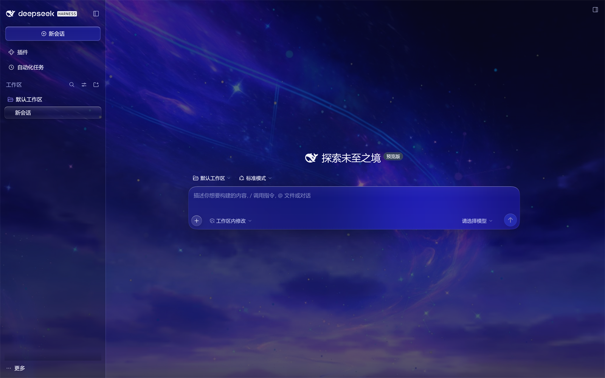
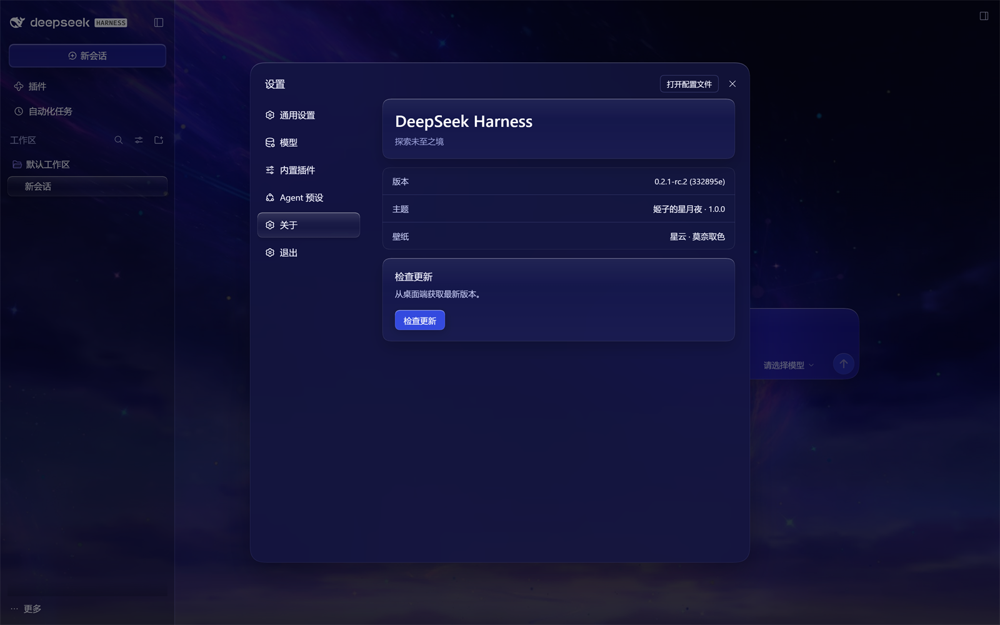
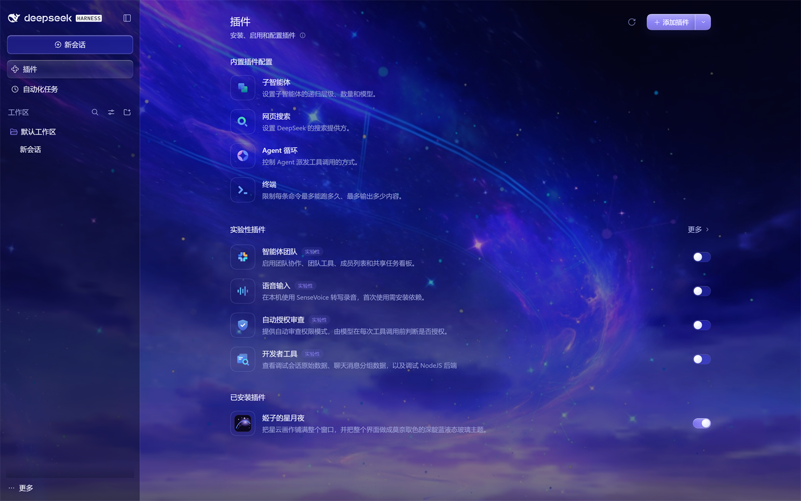
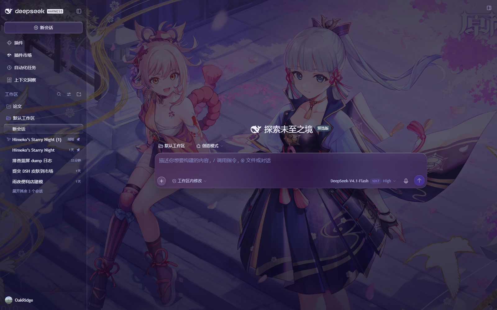

# 姬子的星月夜（Himeko's Starry Night）

DeepSeek Harness UI 的主题插件：星云壁纸 + 莫奈取色 + 液态玻璃。



## 效果

- 星云画作（已裁掉 UID 水印）铺满整个窗口；UI 面板半透明，壁纸色透上来。
- **Material 式动态配色**：每张壁纸先被还原成一枚「种子色」（CIELAB 里有彩像素的面积加权色相 + 平均彩度），主题里所有颜色保留自己的明度、改用种子色的色相、并按种子彩度缩放——换什么壁纸，整张皮就长在什么颜色上；低饱和/黑白图会退化为中性深色，不会乱跳。取色在浏览器里完成，图片只为本机显示存一份。
- 暗色主题锁定：插件在 bundle 层把 DSH 的「外观」偏好默认设为深色，新机器第一次装好、重启 DSH 后就
  直接进入深色（不管系统本身是浅色还是深色）；页面处于深色时，设置里的浅色/暗色选择会被隐藏。
  如果某台机器因为别处的手动配置仍是浅色，这一栏会保持可见，可以手动切回深色。
- 液态玻璃：输入框、消息气泡、新会话按钮、二级菜单（账号/权限/模型/命令/更多/智能体团队）、
  左侧栏行与当前对话、设置导航与设置弹窗、代码块、右侧栏入口卡片与图标。
- 右侧栏全屏：进入全屏时自动隐藏聊天输入框与底部用量条（否则会浮在侧栏页面上），退出后恢复。
- 设置弹窗是**一整块不透明平面**：内容区不叠玻璃、行和卡片无底色、左栏选中项只是一层淡色块——弹窗里从头到尾只有一层材质，不会再出现「框中框」。
- Windows 标题栏：最小化 / 窗口化 / 关闭三枚原生按钮的底色改为透明，直接浮在壁纸上（不再出现
  一条与旁边不同色的暗带）；「应用 / 编辑」按钮的悬停与展开态使用同一套玻璃高亮。
- 「应用 / 编辑」下拉改为插件自绘的液态玻璃菜单（与应用内其它二级菜单同一材质），
  编辑菜单的撤销 / 重做 / 剪切 / 复制 / 粘贴 / 删除 / 全选均可用，不再出现系统原生灰菜单。
- 设置里新增「关于」「退出」两栏（排在 Agent 预设下方）：「关于」展示版本、主题与壁纸信息，
  并提供检查更新；「退出」是真正退出应用的入口（会关闭整个 DeepSeek Harness）。
- 设置里新增「背景」栏（面板名叫「星辰画布」）：星空是启程的地方，不是尽头。把本机的一张照片或一段视频铺成整扇窗的宇宙——
  照片缓慢漂移（Ken Burns），视频静音循环；底图之上仍是同一层深蓝玻璃蒙版，面板可读性不变。
  支持 JPG / PNG / WebP / GIF / AVIF 与 MP4 / WebM，上限 512 MB；文件只写在本机（`~/.dsh/star-wallpaper/`），
  不走网络、不进安装包；「恢复星云」一键回到姬子的星云。设置壁纸后，启动屏的底图也会跟着换成这张照片。
- 默认星云同样参与取色：没放照片时也会从星云里取种子色，图标和主题色不会和背景脱节。
- 启动屏：宿主端通过 `webserver/index-inject` 注入一层 `[data-dsh-boot]` 作用域的样式，
  启动页不再是纯黑 HARNESS：星云壁纸 + 液态玻璃胶囊 + 官方 deepseek HARNESS 标志 + 鲸鱼尾巴
  加载动画 + 「正在点亮星月夜…」+ 底部主题落款。`dsh web` 首帧即生效；桌面端在下一次启动时
  由 boot payload 注入（应用启动时采集，装好后重启一次即可看到）。
- 启动交接：自选壁纸从启动屏一路接到应用首帧（宿主把启动屏已经加载过的壁纸地址直接交给首帧），
  不会再先闪一帧默认星云；账号引导的「正在加载设置…」纯加载遮罩也不再显示。
- 「ask_user_question」提问卡：与输入框同款靛蓝玻璃（卡片本体 + 选项面板两层，选项行/答案框/页脚拍平），折叠后的小条也是同一材质。
- 加载指示器统一为鲸鱼尾巴：从 `dsh-client-ui-chat` 的运行时样式里取出官方 28×28 动画 APNG，
  内联进插件并替换全部转圈 loader（附件上传、设置-账号、设置-通用更新指示、CoT 翻译、
  附件缩略图，以及启动屏）。`prefers-reduced-motion` 下自动退回同一只尾巴的静态 SVG。
- 「插件」页与「自动化任务」页：行 hover、筛选 pill、搜索框和按钮统一成液态玻璃材质
  （按钮保留原品牌色，只加玻璃高光/rim；行高光换成菜单同款渐变玻璃）。
- 会话里的定时任务卡片（`schedule_create` 的结果卡）：宿主这张卡自己写死了中性灰填充，不吃主题
  token，所以此前只有它还是原生灰块；现在卡片本体、悬停态和左侧时钟图标块都并入同一套深蓝液态玻璃。
- 插件安装弹窗：「安装源」下拉是一整块玻璃面板，选项行保持透明扁平，不再逐行叠玻璃
  （此前每一行都被当成独立面板，层叠透字）；「自定义地址」输入框与提示文字沿用主题材质。
- 输入框下方的用量读数（轮次 / tok/s / tok 总量 / 缓存命中 / 上下文百分比）：一整枚靛蓝玻璃胶囊，与输入框同材质同色相。
- 设置 → 背景新增「压暗」滑条：0–100%，0% 完全不压暗、65% 约等于旧版最深档、100% 再深约 1.5 倍；自定义壁纸与默认星云都受它控制，数值存在本机。
- 侧栏 / 顶部工具条 / dock 图标统一取色：所有图标走同一套滤镜，色相来自壁纸种子色；品牌标志保持原色。
- 顶部会话工具条（智能体团队 / 创造模式 / 子智能体 / 后台任务 / 回收站 / 文件管理器 / 更多）悬停时是液态玻璃高光。

## 界面截图

下面几张是浏览器版（`dsh web`）实拍，未做后期——只隐去了侧栏里个人的会话条目与账号名；桌面端的
窗口标题栏按钮与启动屏略有不同，其余材质一致。

| 设置 · 关于 | 插件页 |
| --- | --- |
|  |  |

把「背景」换成一张照片之后（同一套玻璃材质，色相跟着照片走）：



## 已知限制

- 设置里的「退出」执行的是真正的退出（`window.close()` 在此桌面端会关闭整个应用），
  正在运行的任务会随之中断；「应用」菜单里原生的「退出」行为相同。
- 「应用」菜单里原生条目的「管理 dsh 命令…」由主进程独占的对话框提供，页面无法调用，
  因此没有迁移到自绘菜单中；「关于」「退出」已按要求放进设置。
- 「应用 / 编辑」的玻璃下拉依赖桌面端 preload 注入的标题栏按钮（Windows 桌面版）；纯浏览器
  打开 Web UI 时没有这两个按钮，插件不会注入任何额外菜单。
- 启动屏与首帧交接样式只在启动页/交接期间生效；桌面端本次运行期间不会出现（boot 注入在宿主启动时采集），
  重启一次 DSH 桌面端后生效。
- 「背景」只存在本机：文件写入 `~/.dsh/star-wallpaper/`，不上传、不进入插件包，卸载插件也不会自动删除；
  想彻底清掉它，删掉该目录即可。

## 兼容性

1.2.0 起，皮肤层不再按 DSH 的完整哈希类名书写，而是改成**语义钩子**：`data-*` 属性、`aria-label`、`role`，
以及类名里稳定的语义后缀（如 `_card` / `_entry` / `_iconButton`）。DSH 再重哈希前缀时，这些规则仍然命中；
真正失效时只会「局部褪色」，不会整片崩掉。

**支持的 DSH Web 版本：`>=0.2.1-rc.3 <0.3.0`**（在 `0.2.1-rc.3` 的 Web 版与桌面端实测完整适配）。
更旧的版本（如 `0.2.1-rc.2`）会退到「部分适配 / 基础模式」：壁纸、动态配色与基础变量仍然生效。
更高的大版本可能再次调整语义钩子，等本插件更新后再用。兼容范围同时写在 README 与 package.json 的
`devDependencies`（`@deepseek-ai/dsh-*` 的版本区间）里，皮肤市场与安装前核对都以它为准。

插件启动时会做一次「UI 指纹」检查：

- 设置 → 关于 里多了一行「兼容状态」和「界面锚点」：
  - **完整**：当前 DSH 前端与主题构建时一致，全部皮肤生效；
  - **部分适配 / 基础模式**：检测到 DSH 前端已变化，插件会如实显示降级状态；壁纸与基础变量继续生效，
    组件皮肤静默失效，不会把宿主拖崩；
- 控制台会打印一行 `[star-wallpaper] DSH <版本> · compat <等级> · anchors <n>/<m>`；
- 也可以在页面控制台查看 `window.__SWS_COMPAT__` 核对当前状态；
- 稳定锚点：输入框、发送/添加按钮、会话头部控件等核心组件会在运行时被标上 `data-sws-*`，
  玻璃样式同时挂在锚点上——即使下次 DSH 重哈希类名，这些最显眼的部位仍然保持主题材质。

升级 DSH 后想快速比对：`node tools/selectors-report.mjs` 会列出模板里所有依赖类名的选择器
（`--json` 输出结构化结果），适合适配新版本时看差异。

兼容范围就写在上面那两处（README + package.json 的 `@deepseek-ai/dsh-*` 区间）里，供皮肤市场索引和
安装前核对；主题刻意不声明 `peerDependencies` 或 `engines.dsh`，所以 DSH 的启动兼容闸门不会硬拦它——
超出声明区间时它照常加载，由上面那行「兼容状态」如实降级，不会把宿主拖崩。如果「关于」里显示的不是
「完整」，等本插件更新，或先在插件页停用它、用原生界面。

## 素材与版权

- **星云壁纸**（`assets/nebula.jpg`、`assets/boot.jpg`）：取自游戏《崩坏：星穹铁道》4.4 版本的 CG，
  版权归米哈游（miHoYo）所有。这里仅作个人欣赏与主题装饰使用，不做任何商业用途；
  如果要二次分发或商用，请自行替换为拥有授权的图片。
- **deepseek HARNESS 标志**（`assets/brand-lockup.svg`）与**鲸鱼尾巴加载动画**（`assets/whale-tail.png`）：
  取自 DeepSeek Harness 官方前端资源，版权归 DeepSeek 所有，这里只用于本主题的界面装饰。
- **README 例图里的自定义背景**（`preview-background.jpg`）：
  取自游戏《原神》的官方美术，版权归米哈游（miHoYo）所有，仅用于演示「自定义背景」效果。
- 其余 CSS / JS 代码与 `icon.svg` 为本项目原创，使用 MIT 许可证。

## 安装

```bash
# 从 GitHub 安装（推荐）
dsh plugin add https://github.com/Yoimiya-Lover-0621-01/himeko-starry-night

# 或从本地目录安装
dsh plugin add "D:\path\to\dsh-star-wallpaper"
```

或在 Harness 的「插件 → 添加插件」里选择本目录。安装后重启/刷新 Web UI 生效。

> 安装（或更新）本插件后请**重启一次 DSH**：「外观偏好默认值」写在 bundle 层，只在宿主启动时读取；
> 只刷新页面的话，皮肤会更新，但外观默认值要等下一次启动才生效。如果重启后仍是浅色，说明当前 profile
> 的 `cordis.patch.yml` 里有一条显式的 `ui-theme` 外观配置覆盖了插件默认值——把它删掉，或直接在
> 设置 → 通用 → 外观里手动选「深色」（插件在浅色下会保留这一栏）。

## 目录

- `client.js`：构建产物（勿手改）
- `index.js`：宿主半边，负责往启动页注入样式，并提供「背景」需要的本机存图路由；启动不依赖它也能正常进入应用
- `tools/client.template.js`：样式与逻辑源文件
- `tools/build-client.mjs`：构建脚本（把壁纸与鲸鱼尾巴内联成 base64）
- `tools/selectors-report.mjs`：类名选择器清单（适配新 DSH 版本时比对用）
- `assets/nebula.jpg`：裁切后的星云画作（3051x1295）
- `assets/boot.jpg`：启动屏用压缩壁纸（1600x679）
- `assets/brand-lockup.svg`：从官方品牌组件提取的 deepseek HARNESS 标志
- `assets/whale-tail.png`：官方 28×28 鲸鱼尾巴 APNG（从 ui-chat 运行时样式提取）
- `assets/whale-tail-still.svg`：同一只尾巴的静态 SVG（reduced-motion 回退）
- `preview.png` / `preview-settings.png` / `preview-plugins.png` / `preview-background.jpg`：
  README 里的界面截图（浏览器版，侧栏个人会话已隐去）
- `cordis.patch.yml`：把本插件挂进 bundle，并把外观偏好默认设为深色
